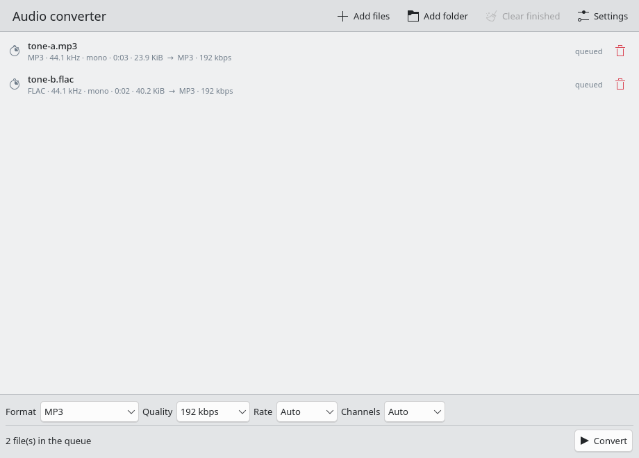
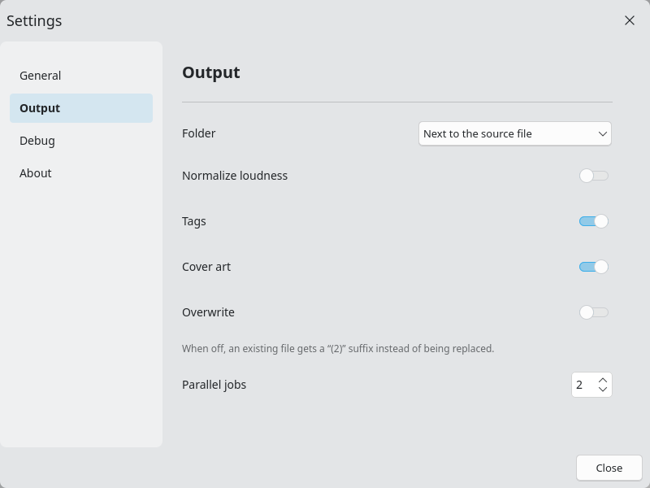
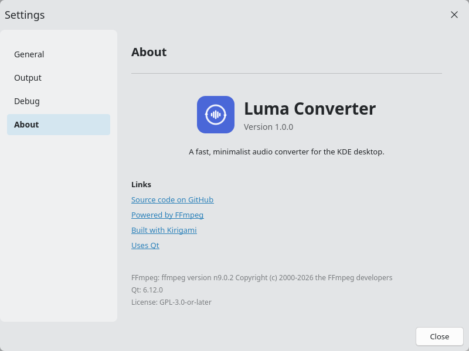

# Luma Converter

Audio converter for the KDE desktop: a Kirigami/Qt Quick front end for FFmpeg.
It is a sibling of [Luma](../luma), the video player, and follows the same
structure, conventions and packaging.



## Features

- **Batch queue.** Add files with a dialog, drag and drop, a whole folder
  (searched recursively) or on the command line.
- **Formats:** MP3, M4A (AAC), Opus, OGG Vorbis, FLAC, ALAC and WAV, chosen
  from a bar at the bottom of the window.
- **Quality:** bitrate for lossy codecs, compression level for FLAC, sample rate
  and mono/stereo downmix — per batch, applied to every file.
- **Tags and cover art** are copied when the target container supports them
  (disabled automatically for WAV).
- **Optional loudness normalization** (EBU R128, −16 LUFS, −1.5 dBTP).
- **Output folder:** next to the source file or a chosen directory. Existing
  files are never overwritten silently: the result gets a `(2)` suffix unless
  *Overwrite* is enabled. Files are written to a temporary name first, so an
  interrupted conversion never leaves a half-written track behind.
- **Parallel jobs** (1–16) with per-file progress, speed, pause/resume, stop and
  readable per-file errors.
- **Desktop notifications** when a batch finishes.
- English and Russian interface, switchable in Settings without a restart,
  remembered settings and window size.

Settings follow the Luma layout: General, Output, Debug and About. The output
folder, tags, cover art, overwrite mode and parallel jobs live there, while the
format and quality stay on the main window.



About is the last settings category:



## Requirements

- Qt 6.6 or newer (Core, Gui, Quick, QuickControls2, Widgets, DBus)
- Kirigami 6 and `qqc2-desktop-style` for the QML controls style
- FFmpeg (`ffmpeg`, `ffprobe`) at runtime

## Build

```bash
cmake -B build -S . -DCMAKE_BUILD_TYPE=Release -DCMAKE_INSTALL_PREFIX=/usr
cmake --build build -j$(nproc)
sudo cmake --install build
```

The binary is `build/bin/luma-converter` (not `build/luma-converter`).

Autotests are opt-in:

```bash
cmake -B build -S . -DLUMA_CONVERTER_BUILD_TESTS=ON
cmake --build build -j$(nproc)
ctest --test-dir build --output-on-failure
```

`tst_formats` and `tst_config` are pure unit tests; `tst_conversion` runs a real
ffmpeg conversion and is skipped when ffmpeg is missing.

## Usage

```bash
luma-converter                 # open the window
luma-converter song.flac ...   # open with files already queued
```

Drop files onto the window, pick a format at the bottom and press **Convert**.
A single ffmpeg process is started per file; the current one can be cancelled
from its row.

## Files and settings

| Path | Contents |
|---|---|
| `~/.config/luma-converter/luma-converter.conf` | settings (INI) |
| `~/.cache/luma-converter/converter.log` | log (rotated at 1 MiB) |

`ffmpeg` and `ffprobe` are resolved from `PATH`; install FFmpeg with the
distribution's package manager. There is no separate path setting.

## Translations

`locales/en.ts` and `locales/ru.ts` are compiled at build time and installed to
`share/luma-converter/translations`. Sources of the strings are translation keys
(`qsTr("page_title")`), so the same key is reused across the UI.

## License

GPL-3.0-or-later.
